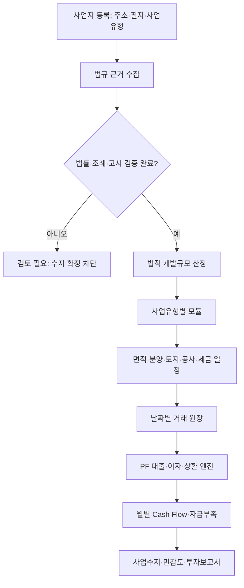

# 전국 시행사업 분석 시스템 체계도

## 사업유형 모듈
- 일반 공동주택: 분양상품·주택건설사업계획·기반시설 부담
- 역세권 정비: 정비계획·공공기여·의무임대·공공매입·조합/시행구조

## 우선순위
법률 및 특별법 > 시행령/시행규칙 > 위임된 조례 > 개별 도시관리계획·지구단위계획·정비계획·인허가 조건을 종합 검토합니다. 단순 서열이 아니라 각 규정의 적용범위와 위임관계를 판단해야 합니다.
